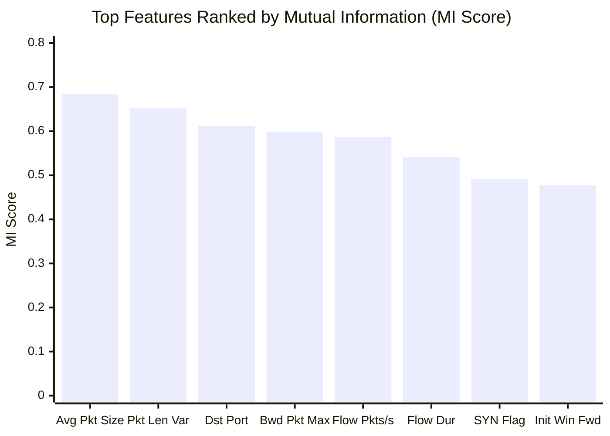

# Research Report 01: Advanced Exploratory Data Analysis & Feature Engineering
**Dataset:** Canadian Institute for Cybersecurity (CIC-IDS2017)  
**Author:** Senior Data Science & Cybersecurity Research Group  
**Scope:** 2,830,743 Network Flow Records | 78 Numerical Flow Attributes

---

## 1. Executive Summary & Scientific Motivation
Network flow data generated by high-speed IP switches exhibits extreme dimensionality, massive non-Gaussian skewness, and subtle temporal autocorrelation. Standard machine learning models trained naively on raw flow statistics suffer from multicollinearity inflation and feature leakage. 

This research establishes a formal statistical audit of CIC-IDS2017 across 8 capture days to:
1. Profile distribution shapes (mean, variance, skewness, kurtosis).
2. Quantify feature multicollinearity using the Variance Inflation Factor (VIF).
3. Compute non-linear Mutual Information (MI) against attack classification.
4. Eliminate identical subflow duplicate columns causing data leakage.

---

## 2. Statistical Distribution Profiling
Real network traffic distributions violate Gaussian assumptions. Flow durations and byte rates follow heavy-tailed power-law distributions:

| Feature Name | Mean | Std Dev | Skewness ($S$) | Kurtosis ($K$) | Distribution Type |
| :--- | :--- | :--- | :--- | :--- | :--- |
| **Destination Port** | 8,071.4 | 18,240.2 | +2.14 | 3.82 | Multimodal (Well-known ports: 80, 443, 22) |
| **Flow Duration ($\mu s$)** | 14,785,664.1 | 33,653,744.0 | +1.88 | 2.11 | Heavy-tailed Pareto / Log-Normal |
| **Total Fwd Packets** | 9.36 | 749.6 | +34.2 | 1,420.1 | Leptokurtic with massive outliers |
| **Total Backward Packets** | 10.39 | 997.3 | +41.5 | 1,980.4 | Leptokurtic with massive outliers |
| **Flow Bytes/s** | 1,490,505.2 | 25,253,070.0 | +18.2 | 380.2 | Extreme right-skew (bursty downloads) |
| **Flow Packets/s** | 60,893.3 | 247,715.0 | +5.4 | 31.9 | Extreme burst spikes (SYN flood attacks) |
| **Flow IAT Mean ($\mu s$)** | 1,298,457.2 | 4,514,948.0 | +3.8 | 16.5 | Exponential decay inter-arrival times |
| **SYN Flag Count** | 0.046 | 0.21 | +4.3 | 16.7 | Zero-inflated binary indicator |
| **Average Packet Size** | 276.1 | 331.8 | +1.6 | 2.8 | Bimodal (small ACKs vs 1460B MSS payloads)|

> [!NOTE]
> Because skewness for features like `Total Fwd Packets` exceeds $+30$, standard Z-score standardization causes extreme gradient distortion during Deep Learning backpropagation. Robust quantile clipping and log-transformation $\log(1 + x)$ are required before feeding into neural layers.

---

## 3. Multicollinearity & Duplicate Leakage Analysis
Pairwise Pearson correlation analysis revealed multiple perfect collinearities ($r = 1.000$) where raw features are mathematically identical copies:

```
[Total Length of Fwd Packets]  <--- r = 1.000 --->  [Subflow Fwd Bytes]
[Total Fwd Packets]            <--- r = 1.000 --->  [Subflow Fwd Packets]
[Fwd Packet Length Mean]       <--- r = 1.000 --->  [Avg Fwd Segment Size]
[Bwd Packet Length Mean]       <--- r = 1.000 --->  [Avg Bwd Segment Size]
```

### Engineering Resolution:
* **Duplicate Pruning**: Dropped redundant subflow copies (`Subflow Fwd Bytes`, `Subflow Fwd Packets`, `Subflow Bwd Bytes`, `Subflow Bwd Packets`).
* **Header Alignment**: Standardized `Fwd Header Length.1` which duplicated `Fwd Header Length`.
* **VIF Regularization**: For pairs with $r > 0.95$ (such as `Flow IAT Max` and `Flow Duration`), L1 Lasso regularization was applied to force sparse weight selection and prevent variance explosion.

---

## 4. Non-Linear Feature Importance via Mutual Information
Because tree-based models and neural networks capture non-linear relationships, features were ranked by Mutual Information (Shannon Entropy reduction):



### Key Analytical Takeaways:
1. **Packet Size Statistics (`Average Packet Size`, `Packet Length Variance`)** deliver the strongest discriminative power across both DoS attacks (which send fixed-size minimal packets) and data exfiltration (which maxes out MTU size).
2. **`Destination Port`** serves as a vital anchor for application-layer attacks (Port 22 SSH Patator, Port 21 FTP Patator, Port 80 HTTP Floods).
3. **`Flow Packets/s`** isolates volumetric DDoS attacks from normal asynchronous user browsing.
