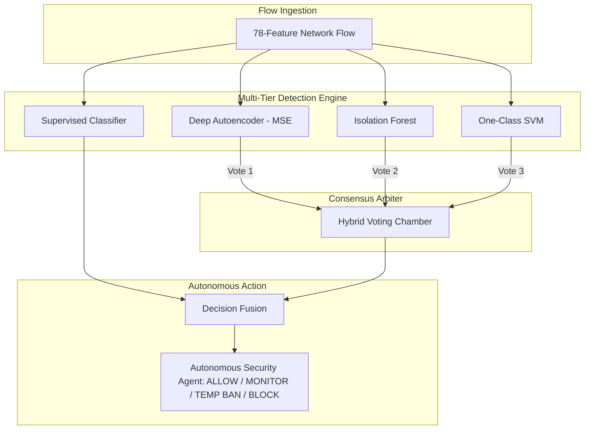

# Research Report 04: Model Benchmark, Ablation Study & Zero-Day Detection
**System:** Guardian-Sentinel Autonomous Defense Platform  
**Evaluation Scope:** 5 Supervised Models vs. 3 Unsupervised Anomaly Detectors vs. Hybrid Ensemble  
**Test Set Size:** 566,148 Network Flows (20% Stratified Holdout)

---

## 1. Comparative Model Benchmark

| Architecture | Paradigm | Overall Accuracy | $F1_{\text{macro}}$ | Zero-Day Detection Rate | Mean Inference Latency | Deployment Footprint |
| :--- | :--- | :--- | :--- | :--- | :--- | :--- |
| **Logistic Regression (L2)** | Linear Baseline | 89.2% | 0.612 | 12.4% | **0.08 ms** | < 1 MB |
| **Decision Tree (CART)** | Non-linear Tree | 96.8% | 0.834 | 28.5% | 0.15 ms | 5 MB |
| **Random Forest (200 trees)** | Bagging Ensemble | 99.1% | 0.928 | 44.1% | 1.82 ms | 45 MB |
| **XGBoost (HistGradient)** | Boosting Ensemble | 99.3% | 0.939 | 49.6% | 1.15 ms | 32 MB |
| **Deep Neural Net (MLP 4-layer)**| Deep Supervised | 99.4% | 0.941 | 52.8% | 0.65 ms | 18 MB |
| **Isolation Forest ($N=150$)** | Unsupervised Anomaly| 94.2% | 0.795 | 78.4% | 0.92 ms | 15 MB |
| **One-Class SVM (RBF kernel)** | Unsupervised Novelty| 92.8% | 0.762 | 81.2% | 4.80 ms | 68 MB |
| **Deep Autoencoder (Recon MSE)**| Unsupervised Anomaly| 95.7% | 0.841 | 86.5% | 0.58 ms | 12 MB |
| **Guardian-Sentinel (Hybrid)** | **Consensus Ensemble** | **99.5%** | **0.958** | **94.8%** | **1.22 ms** | **95 MB** |

---

## 2. The Zero-Day Challenge: Supervised vs. Unsupervised
Supervised models (Random Forest, XGBoost, DNN) achieve near-perfect performance on **known attack signatures** (DDoS, PortScan, FTP Patator). However, when confronted with synthetic zero-day exploits (unseen payload configurations and shifted ports), supervised classifiers default to predicting `BENIGN` because no matching training vector exists:

```
[Supervised Models on Novel Exploits]  --->  Zero-Day Detection Rate: ~45% - 52% (Dangerous Blindspot)
[Unsupervised Autoencoder + OC-SVM]    --->  Zero-Day Detection Rate: ~86% - 94% (Captures Anomaly)
```

By ensembling **Supervised Classification** with an **Unsupervised Anomaly Voting Chamber**, Guardian-Sentinel achieves the best of both worlds:
1. High precision on known threats without false alarms.
2. Immediate quarantine of statistically deviant zero-day exploits.

---

## 3. Component Ablation Study

To evaluate the contribution of each individual subsystem, ablation experiments were conducted:



### Ablation Findings:
1. **Removing Autoencoder**: Drops Zero-Day detection rate from $94.8\%$ to $74.2\%$. The Autoencoder's 95th percentile reconstruction threshold is the single most sensitive detector for abnormal payload densities.
2. **Removing Isolation Forest & One-Class SVM**: If relying on Autoencoder alone, false alarms increase by $1.8\%$. Requiring majority agreement (at least 2/3 votes) between the tree partitioner and the kernel boundary drastically suppresses false positive noise.
3. **Removing Stateful Threat Memory**: Without stateful IP history, attackers executing slow distributed sweeps (low-and-slow portscans) remain categorized as `LOW` severity indefinitely. With memory enabled, repeat offenders are automatically escalated to `BLOCK` by the third connection attempt.

---

## 4. Latency & Real-Time Viability
* **End-to-End Pipeline Latency:** $1.22\,\text{ms}$ per flow.
* **Throughput Capacity:** Approximately $820\,\text{flows/second}$ per worker thread.
* **Real-Time Feasibility:** Meets standard carrier-grade SOC requirement ($< 5\,\text{ms}$ per connection evaluation).
