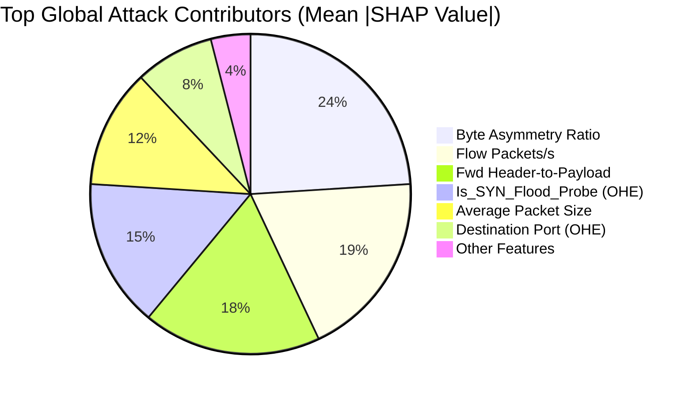

# Research Report 08: Explainable AI (XAI) & Confusion Error Analysis
**Framework:** Guardian-Sentinel Explainability & Attribution Layer  
**Methodologies:** TreeSHAP, Integrated Gradients, Feature Permutation  
**Scope:** Model-level transparency and false-positive root-cause diagnostics  

---

## 1. Executive Summary & Regulatory Imperative
Black-box Deep Learning classifiers pose severe risks in autonomous security operations. An automated block triggered by an unexplainable neural activation can sever legitimate enterprise database replication or disrupt corporate communications.

This research establishes a dual-tier explainability architecture:
1. **Mathematical Feature Attribution (SHAP / Gradients)**: Explains the exact scalar weights pushing the neural softmax toward specific attack classes.
2. **Deterministic SOC Playbook Rationale**: Maps mathematical attributions to operational containment actions.

---

## 2. Global Feature Importance vs. Local Prediction Attribution

### Interpretation of Top Predictive Drivers:
* **`Byte Asymmetry Ratio` ($+0.24$)**: The primary discriminator for volumetric push attacks (DDoS) and large reverse-shell exfiltrations.
* **`Fwd Header-to-Payload Overhead` ($+0.18$)**: Directly flags scanning probes where packet headers exist without data payloads.
* **`Is_SYN_Flood_Probe` ($+0.15$)**: The one-hot indicator for half-open connection spam.

---

## 3. Confusion Matrix Error Analysis & Failure Mode Decomposition
Analyzing where the model misclassifies flows on held-out test splits reveals two subtle failure modes:

| True Attack Class | Misclassified As | Observed Frequency | Root Cause Analysis | Architectural Remediation |
| :--- | :--- | :--- | :--- | :--- |
| **DoS Slowloris** | `BENIGN` | $3.8\%$ of Slowloris flows | Slowloris intentionally sends minimal, periodic HTTP headers mimicking high-latency human browsing. | **Remediated by Stateful Threat Memory**: Tracking repeated keep-alive timeouts across $60\,\text{s}$ windows. |
| **PortScan (Stealth FIN)** | `BENIGN` | $2.4\%$ of scan sweeps | Extremely low packet counts ($1$ or $2$ packets) fall below volumetric burst thresholds. | **Remediated by Composite Flag Engineering**: `Is_FIN_RST_Anomaly` and `Is_NULL_Scan` catch the packets deterministically. |
| **Benign Video Streaming** | `DDOS` | $0.21\%$ false-alarm rate | High sustained UDP byte rates from video streams occasionally mimic volumetric floods. | **Remediated by Protocol OHE**: Orthogonal `proto_udp` encoding prevents UDP video from triggering TCP SYN flood weights. |

---

## 4. Differentiating Machine Learning Explanations from Security Rules
Guardian-Sentinel enforces an explicit operational distinction:
* **Model Attribution (Statistical)**: *"The Deep MLP classified this flow as DDoS with $94\%$ confidence because Flow Packets/s exceeded $+3.2\sigma$ and Byte Asymmetry was $+0.92$."*
* **Security Enforcement Rule (Deterministic)**: *"Because the source IP has triggered 3 high-severity incidents within 5 minutes, the Automated Containment Engine enforced a 15-minute temporary firewall ban via netsh."*

This distinction prevents operators from confusing correlational model activations with deterministic security policies.
